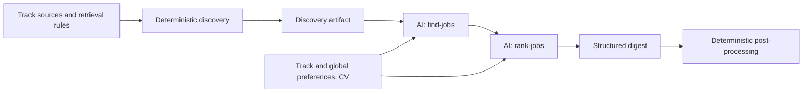
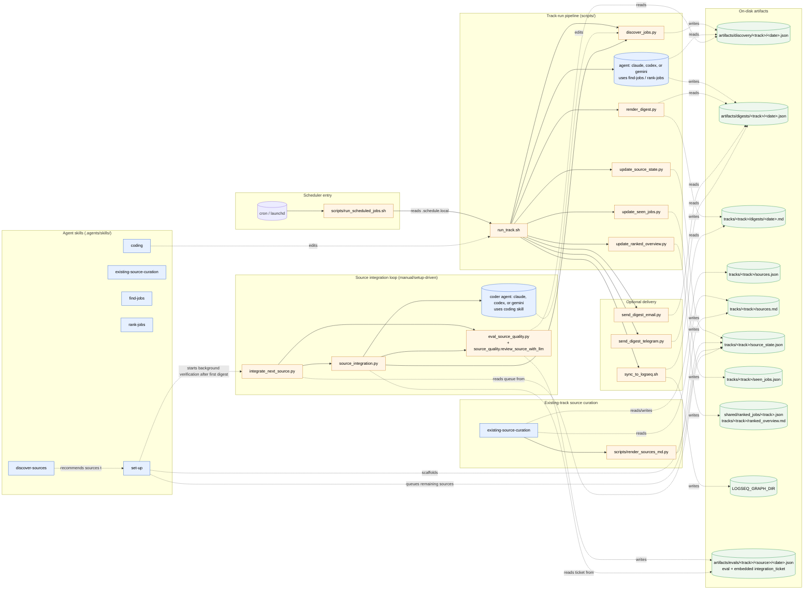
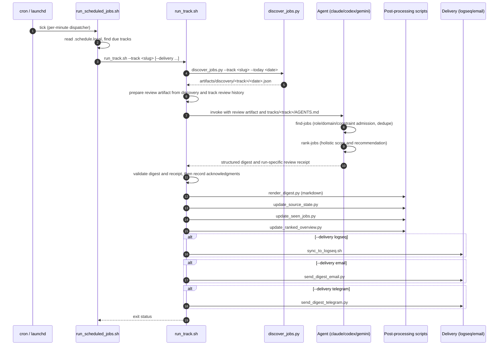
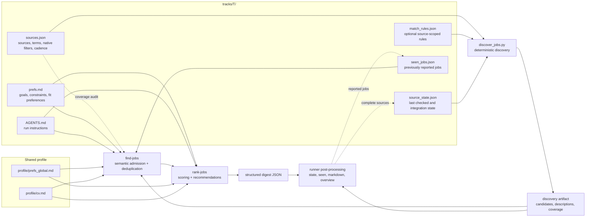
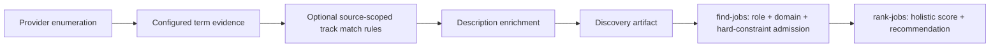
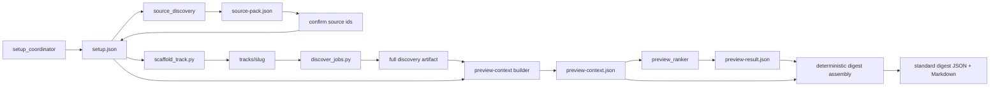
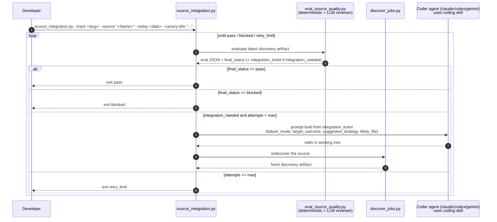

# Architecture Overview

This repo runs an agent-assisted job-search workflow. Each track combines deterministic Python helpers under `scripts/` with agent-driven skills under `.agents/skills/`. This page explains the main data flow and component responsibilities; agent work modes are defined in [`AGENTS.md`](../AGENTS.md), and per-source detail lives in the auto-generated [`shared/discovery_modes.md`](../shared/discovery_modes.md).

## System at a glance

Each **track** defines where to search and what the user considers relevant. Deterministic discovery collects candidates; agents determine relevance and priority; scripts maintain state and produce the digest.



### Component responsibilities

| Component | Responsibility |
| --- | --- |
| Discovery providers | Enumerate and extract postings using configured terms and native filters; report coverage. |
| Optional `match_rules.json` | Apply source-scoped deterministic candidate filtering. |
| `find-jobs` | Assess semantic role/domain fit and hard constraints; deduplicate candidates. |
| `rank-jobs` | Score and recommend among admitted candidates. |
| `run_track.sh` and post-processing scripts | Orchestrate runs, render digests, and maintain source, seen-job, and ranked state. |
| Setup and source-integration workflows | Create and maintain tracks and provider integrations outside scheduled runs. |

Retrieval configuration and semantic preferences are intentionally separate. Source configuration may be reconciled with preferences during explicit maintenance, not as a side effect of scheduled runs. These responsibilities describe the system design; the [reviewing skill](../.agents/skills/reviewing/SKILL.md) defines how to assess changes against it.

## Component map

The flowchart expands the overview into the main implementation workflows. Code review and harness-launched sessions are not separate runtime pipelines. Solid arrows are direct calls or invocations; dashed arrows indicate artifact reads and writes.



## Scheduled track run, end to end

The sequence diagram shows what happens for a single scheduled run.

Before discovery, `run_track.sh` resolves and logs the [scheduled agent's model policy](machine_setup.md#agent-model-selection).
Both `find-jobs` and `rank-jobs` run in the same session. Manual runs through
`run_track.sh` use the same policy.



## Track configuration and information flow

Each track `T` has two independent kinds of input: **retrieval configuration** (`sources.json` and optional `match_rules.json`) and **semantic preferences** (`prefs.md` plus the shared profile). Deterministic discovery does not read the CV or preference files; agents use them *after* retrieval.



| Canonical location | Contents | Consumer |
| --- | --- | --- |
| `profile/cv.md` | Experience and skills | `find-jobs`, `rank-jobs` |
| `profile/prefs_global.md` | Cross-track preferences and constraints | `find-jobs`, `rank-jobs` |
| `tracks/T/prefs.md` | Track goals, role families, domain requirements, exclusions, priorities | `find-jobs`, `rank-jobs`; overrides conflicting global preferences |
| `tracks/T/AGENTS.md` | Track workflow and setup-derived fit summary | Track agent; `prefs.md` remains authoritative for fit |
| `tracks/T/sources.json` | Sources, cadence, `track_terms`, source `search_terms` (`append`/`override`), native filters | Discovery; `find-jobs` coverage audit |
| `tracks/T/match_rules.json` (optional) | Source-specific deterministic rules | Discovery, before fallback description enrichment |
| `tracks/T/reference_jobs.json` (optional) | Durable posting URLs, user relevance notes and source associations | Setup/curation; finding and ranking calibration |
| `tracks/T/source_state.json` | Last successful source checks, canaries, review history, verification and integration queue state | Discovery cadence; updated by scripts for complete sources |
| `tracks/T/seen_jobs.json` | Previously reported jobs | `find-jobs` deduplication; updated from the digest by scripts |

`tracks/T/sources.md` is generated from `sources.json`; it is not another source of truth. Discovery writes `artifacts/discovery/T/YYYY-MM-DD.json`; the agent produces `artifacts/digests/T/YYYY-MM-DD.json`. The runner renders `tracks/T/digests/YYYY-MM-DD.md` and updates `tracks/T/ranked_overview.md` and `shared/ranked_jobs/T.json`.

For scheduled runs with a fresh discovery snapshot, the runner supplies `artifacts/reviews/T/<run-id>.json` to the agent. It retains source coverage and match counts while supplying listing bodies for new candidates and candidates with changed posting evidence or fit criteria. The agent writes a run-specific receipt and drafts any new or updated digest alongside it. After validating both outputs, the runner installs the digest and records reviewed and deferred versions in `tracks/T/candidate_review_history.json`. `seen_jobs.json` continues to control repeat reporting. Fallback runs use the existing discovery workflow and leave review history untouched.

**Recall boundary:** A restrictive retrieval term, native filter, or match rule can exclude a job *before* `find-jobs` sees it. A successful scrape therefore proves execution of the configured search, not that the configuration covers every desired role. See [Retrieval maintenance and coverage](#retrieval-maintenance-and-coverage) for the separate audit and reconciliation workflow.

The first setup preview uses a different, bounded `preview-context.json` projection for `preview_ranker`; this diagram covers normal track runs.

## Candidate filtering boundary

Configured `sources.json` `track_terms` and source-specific `search_terms` are
retrieval vocabulary. Providers extract postings and compute generic term
evidence; ordinary candidate admission requires non-empty `matched_terms`, not
shared technical/non-technical role policy. Provider-native filters and narrow
source-protocol predicates remain part of enumeration.



The existing optional `tracks/<track>/match_rules.json` hook runs before
fallback description enrichment and reports deterministic removals through
coverage limitations. Its source-scoped rules do not replace semantic track
preferences. `find-jobs` reads those preferences and decides candidate
admission by evaluating role-family fit, domain fit, and hard constraints as
separate questions. `rank-jobs` then re-evaluates the surviving candidates and
assigns `apply_now`, `watch`, or `skip`; it does not search for candidates that
were absent from the artifact.

First-preview selection remains capped at 40 unseen, URL-deduplicated
candidates. Candidates with more configured terms matched in their titles are
ordered first, followed by total matched-term count and stable discovery order.
This priority affects bounded selection only, not eligibility or semantic fit.

## Retrieval maintenance and coverage

`sources.json` owns deterministic retrieval vocabulary and native filters;
`prefs.md`, global preferences and the profile own semantic fit. Per-source
`search_terms` either append to `track_terms` or override them entirely.
Discovery trims and deduplicates terms case-insensitively. These terms are not
automatically compiled from preferences: semantic constraints, exclusions and
ranking signals need not be literal retrieval queries.

`find-jobs` distinguishes two questions:

- **Execution coverage:** did the fresh artifact demonstrate the configured
  work for the due source, accounting for provider strategy and limitations?
  Feed enumeration with local matching counts as term application. Zero matches
  for any or all applied terms can still be complete. Missing execution evidence
  or incomplete enumeration remains a coverage limitation. Unfinished candidate
  review and missing fit evidence must also be reported explicitly.
- **Search quality:** could the configuration miss a requested role family or
  domain? Report a concrete concern in the affected source's existing digest
  `runs[].source_notes[].limitations`, prefixed `Search-quality observation:`.
  Name the requirement, restrictive configuration and possible omission. Missing
  preference words or zero results alone do not establish a gap. Keep otherwise
  successful execution complete; do not claim an actual missed job without evidence.

For example, a source can complete retrieval for `cryptography` while its
limitations note that newly requested privacy engineering roles without that
term may be missed. Observations do not launch maintenance workers, change
configuration or rerun discovery. `rank-jobs` continues scoring the candidates
it receives against semantic preferences.

Users request maintenance with prompts such as "Update my crypto track to
include privacy engineering" or "I edited this track's preferences; reconcile
retrieval." The `existing-source-curation` skill updates semantic preferences when
requested and reviews global terms, all source overrides, native filters and
existing match rules together. Ranking-only changes may require no retrieval
edits. Maintenance reuses source rendering, discovery planning and targeted
checks/canaries where practical, without scaffolding again or overwriting
scheduled artifacts or source state. Configuration changes apply to subsequent
discovery; historical artifacts remain unchanged.

New-track setup reviews alignment before source-pack confirmation, and named
source curation checks the new source's effective terms without silently tuning
unrelated sources. Direct edits to preference files remain unsynchronized until
maintenance is requested; advisory observations cannot guarantee detection or
recall. Existing tracks can selectively adopt the corrected coverage instructions
from the shared template without replacing their custom instructions. No artifact
schema migration is required.

## Guided setup boundary

Guided setup keeps one interactive coordinator but moves costly source discovery and first-preview ranking into two fresh bounded workers. The coordinator persists reviewed decisions under `artifacts/setup/<setup-id>/setup.json`; it does not pass its transcript to either worker.



Setup workers communicate through validated, size-bounded JSON artifacts. The coordinator shares only a reviewed projection of the user's profile and track configuration, never the full conversation or credentials. The first-preview context limits the number and size of candidate descriptions to control model cost and context usage; omissions and truncation are recorded explicitly. Worker results are bound to their inputs using hashes and stable identifiers. The precise limits are defined in `scripts/setup_contracts.py`.

A minimal setup artifact has this synthetic shape:

```json
{
  "schema_version": 1,
  "kind": "jobwatch_setup",
  "setup_id": "20260720T155600Z-a1b2c3d4",
  "profile": {
    "user_name": "Example User",
    "seniority": ["senior"],
    "skills": ["Rust"],
    "experience_signals": ["production cryptography"],
    "positive_signals": ["hands-on ownership"],
    "borderline_signals": ["management-heavy roles"],
    "current_or_recent_employers": ["Previous Employer"]
  },
  "track": {
    "slug": "applied_crypto",
    "display_name": "Applied Cryptography",
    "search_area": "Applied cryptography and privacy engineering",
    "goals_or_role_types": ["Applied cryptography engineer"],
    "keep_only_keywords": ["cryptography"],
    "constraints_or_red_flags": ["No mandatory relocation"],
    "geography_or_remote_preferences": ["Europe", "remote"],
    "fit_language": "Hands-on cryptography roles compatible with reviewed location constraints."
  },
  "source_seeds": {
    "employers": [],
    "sectors_or_organizations": [],
    "career_pages_or_boards": []
  },
  "selected_sources": {
    "track_terms": [],
    "sources": [],
    "match_rules": []
  }
}
```

An empty selected source list is valid before confirmation but blocks `scaffold_track.py`. Persisted source entries and match rules use the same canonical schemas as track `sources.json` and `match_rules.json`. For provider-independent strict worker output, native filters arrive as at most 20 `{key, values}` entries; the validator normalizes them into the existing canonical filter map. Older object-shaped filter maps remain readable.

The deterministic assembler joins candidate judgments back to URLs and source coverage, then emits the existing digest schema. The source runner reads the canonical `discover-sources/SKILL.md` and `shared/source_curation.md` and includes their text inline, followed by its supported-mode and output contract. No workspace access or second instruction copy is needed. Runtime provider policy, isolation, hashes, output validation and persistence remain runner-owned. The two workers cannot write the workspace and never resume the coordinator conversation. Source discovery is web-capable; preview ranking is instructed and configured without routine web access. `scaffold_track.py` has no model role because it makes no model call.

Guided setup uses the shared [agent model policy](machine_setup.md#agent-model-selection)
in `scripts/agent_provider.py`.

## Source selection and portfolio maintenance

`set-up` owns interactive new-track onboarding and the first digest.
`discover-sources` recommends a bounded source pack for new or existing tracks.
`existing-source-curation` owns existing-track additions, portfolio reviews and
preference/retrieval reconciliation. Shared scripts own registration, evidence,
quality checks and integration. Official-source/mode heuristics and the common
operator procedure live in `shared/source_curation.md`.

`curate_sources.py prepare` combines a reviewed setup-format brief with at most
80 canonical existing source records and stored examples; it fails rather than
silently truncating a larger portfolio. Existing configuration is user context,
not authorization to modify it. The worker may associate examples with existing
IDs but cannot recommend duplicates by ID, normalized URL or exact source name.
`register --setup` adds reviewed selections without recreating tracks, changing
global terms or replacing existing sources. New retrieval vocabulary applies only
to additions. Match-rule changes require separate explicit maintenance. Removal,
cadence and consequential filter recommendations remain subject to user control.

### Source evidence contracts

These are optional extensions to v1 artifacts. Existing setup artifacts retain
their normalized shape/hash when the new input fields are absent. Legacy packs
can omit evidence fields; missing seed accounting is rendered explicitly as
unresolved. New workers receive the extended schema. Strict key/URL/ID checks,
32 KiB setup and 128 KiB source-pack limits still apply.

| Artifact | Added fields / purpose |
| --- | --- |
| `setup.json` | `reference_jobs` (up to 20), `canaries` (up to 40, five/source), optional `existing_sources`, and selected `seed_outcomes` |
| `source-pack.json` | One `reference_associations` record per input example (`reference_job_id`, nullable `source_id`, `reason`); `seed_outcomes` for each employer/official URL seed (`seed`, nullable `source_id`, `reason`); bounded `canaries` |
| `preview-context.json` | Durable `reference_jobs` for calibration, never additional candidates |
| `tracks/T/reference_jobs.json` | `{schema_version: 1, track: T, reference_jobs: [...]}`; survives posting closure |
| `source_state.json` per-source `integration` | `canaries`, `canary_checks`, bounded `canary_history`, `verification`, `quality_level`, existing queue/artifact fields |

A reference has `id`, `url`, optional `title`, `employer`, `relevance`, nullable
`source_id` and `association_reason`. Selection preserves all references,
including examples whose recommended source was not selected, and records that
reason. Supplied canaries remain in the setup decision artifact; only selected
or already configured source IDs enter operational state.

An evidence-registration file can contain:

```json
{
  "reference_jobs": [{
    "id": "interesting_role", "url": "https://careers.example.com/jobs/42",
    "title": "Privacy Engineer", "employer": "Example",
    "relevance": "Hands-on privacy protocol work",
    "source_id": "example", "association_reason": "Official employer board"
  }],
  "canaries": [{
    "id": "posting_42", "source_id": "example", "reference_job_id": "interesting_role",
    "url": "https://careers.example.com/jobs/42", "title": "Privacy Engineer",
    "posting_id": "42", "provenance": "user_supplied", "availability": "live",
    "scope": "in_scope", "checked_on": "2026-11-17", "expires_on": "2026-12-01",
    "evidence_url": "https://careers.example.com/jobs/42",
    "evidence_note": "User independently confirmed the official vacancy is open."
  }]
}
```

Canary provenance is `user_supplied`, `official_page`, `independent_probe`,
`discovery_output` or backward-compatible `legacy`. Availability is `live`,
`expired` or `unknown`; scope is `in_scope`, `out_of_scope` or `unknown` and
refers to intended preferences, so restrictive retrieval cannot excuse a miss.
Confirmed availability requires a dated evidence URL and note. Review deadlines
default to 14 days; they never assert closure. Reference IDs/URLs/source
associations are cross-validated. Evidence files are limited to 64 KiB.

### Verification and evidence lifecycle

The evaluator automatically reads all stored canaries. A current in-scope
canary's absence fails even with plausible, complete results. Posting IDs take
precedence when both sides provide them; otherwise normalized primary/alternate
URLs are compared. Job-defining query parameters are retained; known tracking
parameters and fragments are ignored. Title matching is only allowed when the
canary has no stronger identity.

A same-day explicit observation supplies availability evidence. Older missing,
unknown or stale postings receive a separate bounded official-vacancy check.
HTTP 404/410 or an expired matching JobPosting validity date establishes closure;
a matching current JobPosting with role detail supplies live evidence. Dynamic,
blocked, redirected or ambiguous pages remain inconclusive and can be reviewed
manually. This conservative generic check does not cover all ATSs. Stored
observations are never erased by inconclusive evaluation.

`update_source_canary.py` archives a posting only after independent closure is
confirmed. It then probes official pages before falling back to a discovery
suggestion; every new suggestion requires intended-scope review. A live missing
canary remains a defect. Unknown checks preserve the prior record alongside the
latest observation. Discovery-output/legacy provenance remains weaker even after
availability review. The last 100 archived canary observations are retained;
durable reference jobs are never pruned by rotation.

Evaluation uses the latest dated review, including unknown availability or scope,
while retaining the earlier record as prior evidence. A same-day review is honored;
older unknown observations can be resolved by a fresh independent availability check.

Evaluator `verification` is `unverified`, `inconclusive`, `regression_only`,
`failed` or `independently_verified`. `quality_level` distinguishes `configured`,
`basic_support` and `independently_verified`; verified means a sampled independent
check, never exhaustive coverage. No-canary tracks continue operating normally.
Deterministic track-rule rejections retain up to 100 posting identities for
failure attribution. Enumeration vs search terms/native filters cannot always be
separated from the current artifact; tickets state that uncertainty. Detail
extraction has separate existing quality checks.

Evidence mutations use the existing state lock and atomic replacement. Long
integration runs overlay only their operational result fields; concurrent canary
or cadence changes survive and invalidate a stale verification result. Source
registration locks configuration/reference files, validates before writes and
supports idempotent retries. These files commit individually, not as one database
transaction. Legacy singular `integration.canary` and title/URL fields load as
review-needed evidence; they are migrated lazily when evidence is changed.

## Source integration loop

New sources should be integrated in layers. First choose the best existing `discovery_mode`; then tune source-specific `search_terms` and native `filters` from the user's CV and preferences; then add provider filter support; only then add dedicated provider parsing or enumeration logic. The source integration loop in `scripts/source_integration.py` automates the coding-and-reevaluation part of that process for one source.

Both scaffolding and existing-track registration queue sources in `source_state.json`. The first setup digest completes before expensive verification. `start_source_integration.py` starts bounded background work through `integrate_next_source.py`; explicit maintenance can queue affected sources through `curate_sources.py queue`. The same discovery/evaluator/config-tuning path handles all sources, including those reporting complete execution. Available, in-scope canaries must be found. Inconclusive availability defers integration, and track-rule changes require preference review. This queue is never drained by scheduled track runs.

The reviewer role lives **inside each re-eval cycle**, not as a separate step between attempts. `scripts/eval_source_quality.py` runs a deterministic validator (`source_quality.validate_source_coverage`) and an LLM reviewer (`source_quality.review_source_with_llm`) over the discovery output; if defects remain, the eval emits an `integration_ticket` with a next action such as `config_terms_override`, `config_terms_append`, `config_native_filters`, `provider_filter_support`, or `dedicated_provider_logic`.



### Source integration artifacts

All source-integration-loop output lands under `artifacts/evals/<track>/<source_slug>/`:

- `<date>.json` — eval result with embedded `integration_ticket` (the canonical input to the next coder attempt)
- `<date>.source_integration_loop.json` — summary of the entire loop (phases, attempts, final status)
- `<date>.discovery.json` — fresh discovery artifact captured after a coder attempt
- `<date>.attempt<N>.coder.stdout.jsonl` / `.stderr.log` / `.last_message.txt` — per-attempt coder logs
- `<date>.attempt<N>.postmortem.json` — failure analysis written after a blocked attempt; fed back into the next attempt's prompt as prior context

When an integration lands a working fix, push the branch from your fork and open a PR per [`CONTRIBUTING.md`](../CONTRIBUTING.md) — the loop ends at the working-tree fix; upstreaming is the standard fork-and-PR flow.

## Where to read next

- [`AGENTS.md`](../AGENTS.md) — mode routing rules.
- [`README.md`](../README.md) — user-facing setup, manual runs, scheduling, delivery.
- [`shared/discovery_modes.md`](../shared/discovery_modes.md) — auto-generated catalog of every supported provider.
- [`docs/contributing/adding-sources.md`](./contributing/adding-sources.md) — how to add a new discovery source.
- [`CONTRIBUTING.md`](../CONTRIBUTING.md) — fork-and-PR workflow for code or doc contributions.
- Per-skill instructions live under `.agents/skills/<skill>/SKILL.md` (canonical) and mirror to `.claude/skills/<skill>/SKILL.md` via `bash scripts/sync_claude_skills.sh`.
